# Screenshots

  English | <a href="README.zh-CN.md">简体中文</a> | <a href="README.zh-TW.md">繁體中文</a> | <a href="README.ja.md">日本語</a> | <a href="README.ko.md">한국어</a> <a href="README.fr.md">Français</a> | <a href="README.de.md">Deutsch</a> | <a href="README.es.md">Español</a> | <a href="README.it.md">Italiano</a>

### Main dashboard

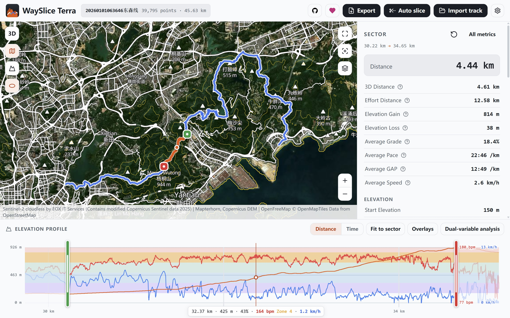

### 3D map

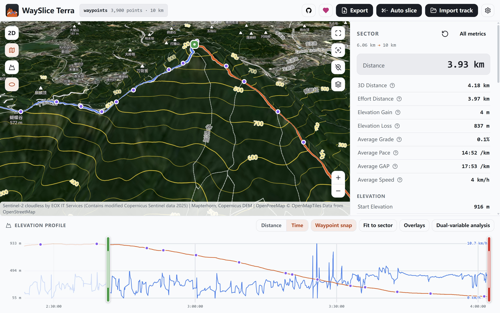

### Dark mode

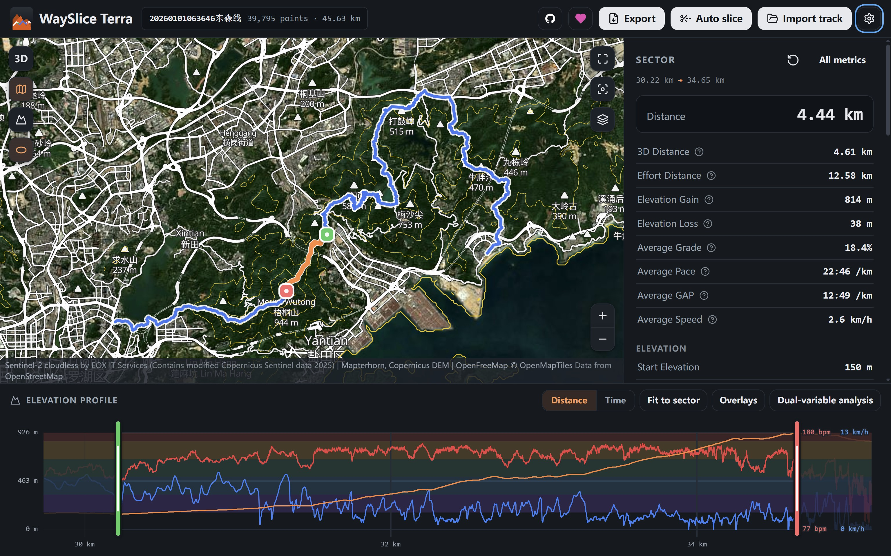

### Mobile

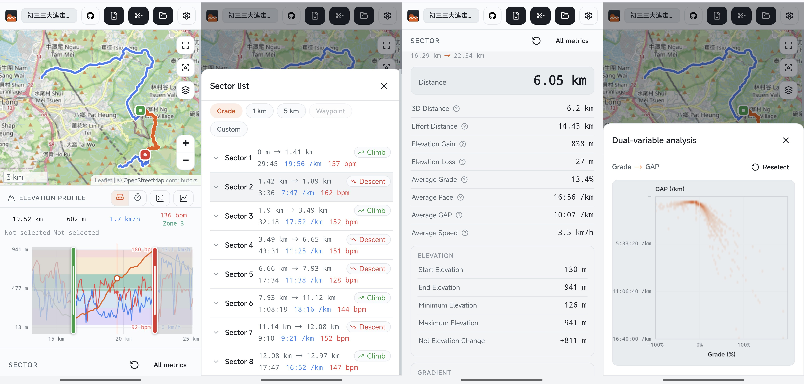

### Time as X-axis

### Auto slice

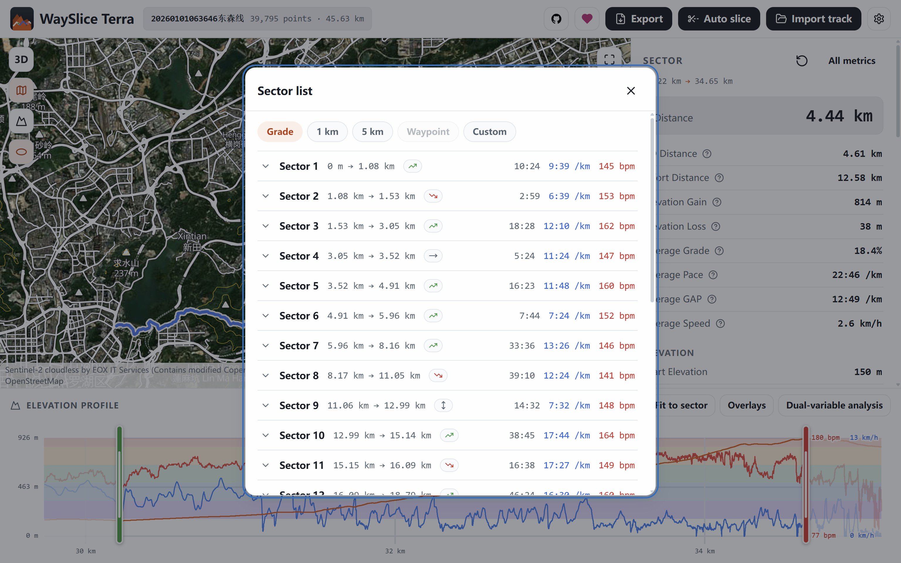

### All metrics

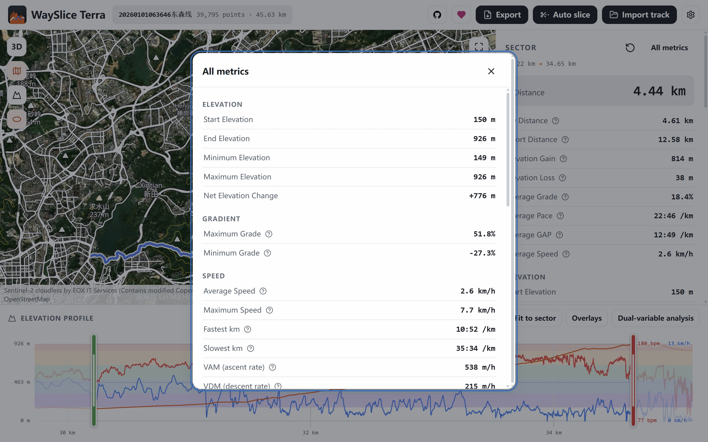

### Multiple basemap

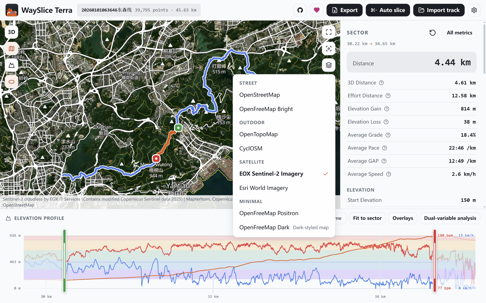

### Waypoint info

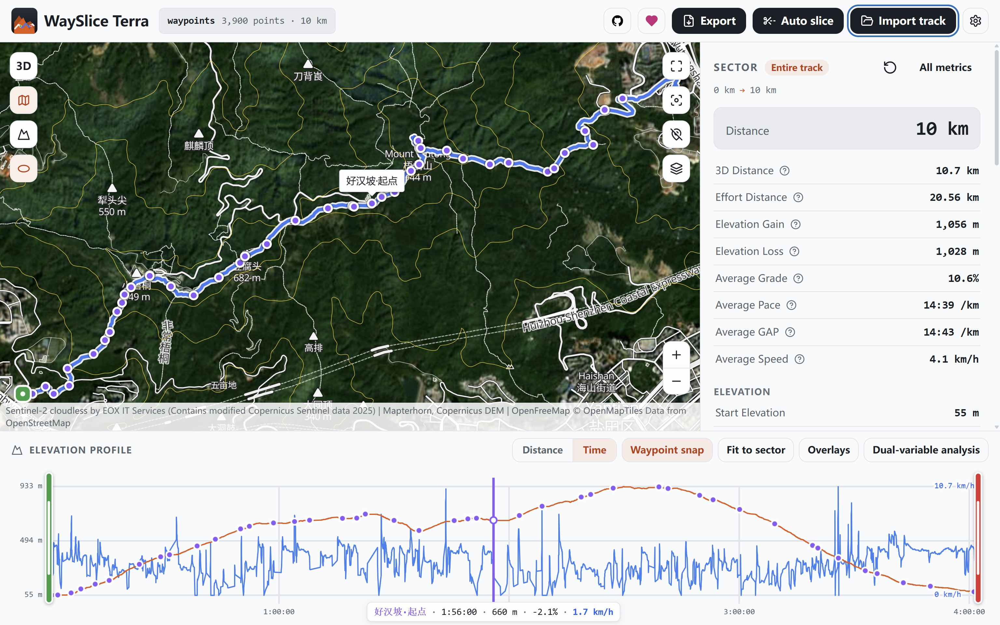

### Waypoint snap

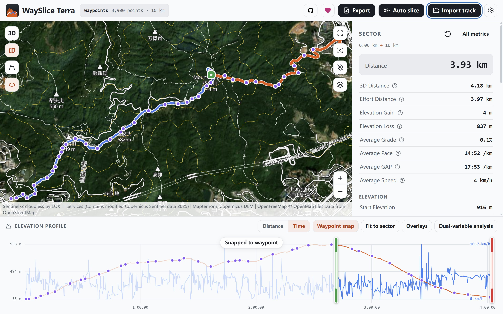

### Dual-variable analysis

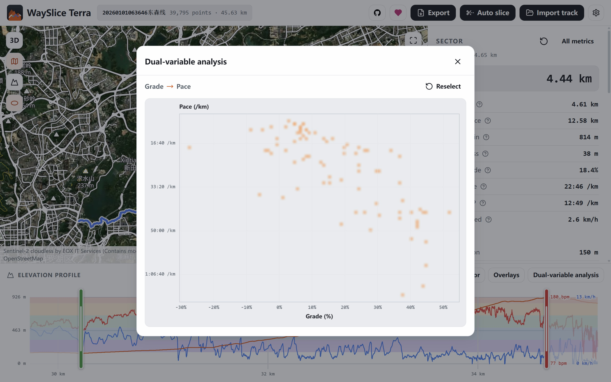

### File export

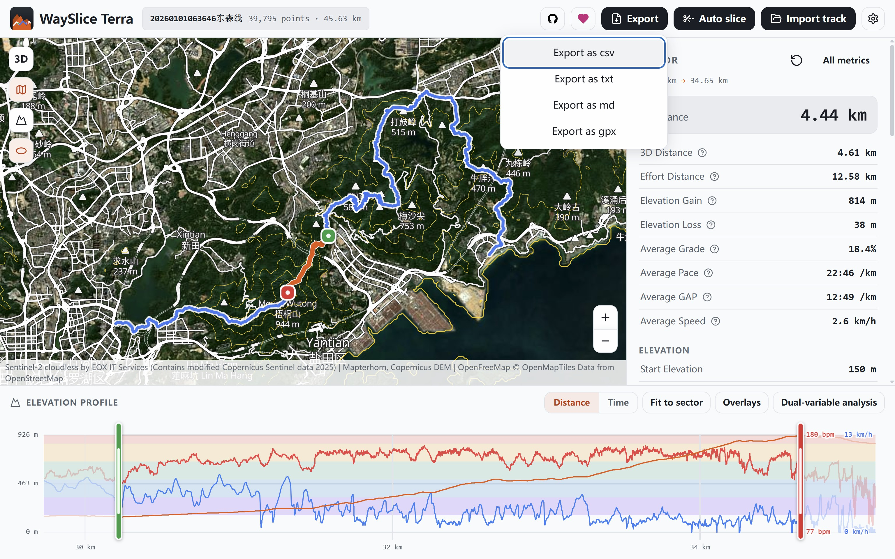

### Settings

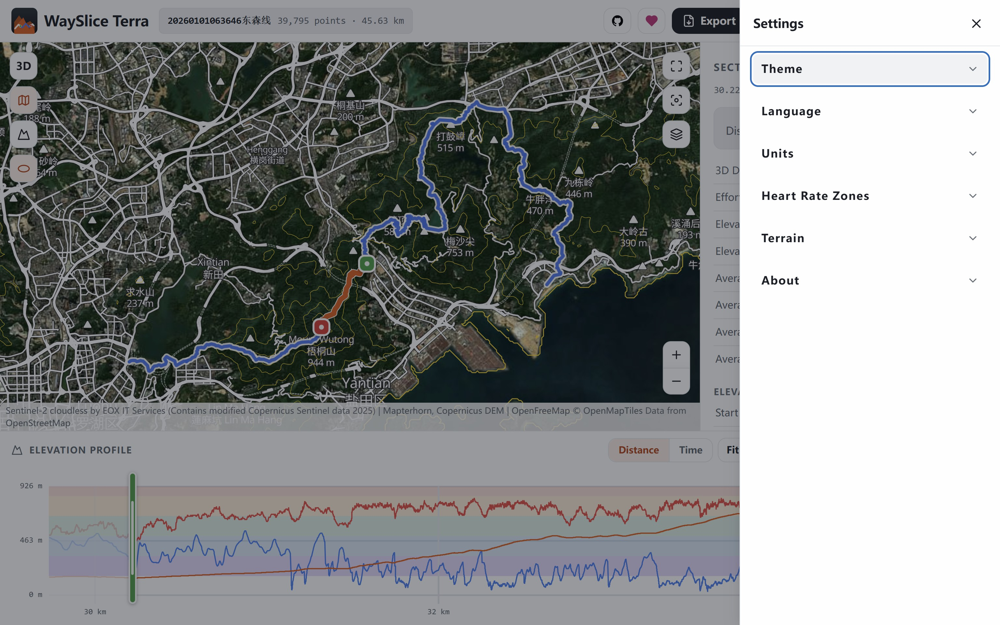
